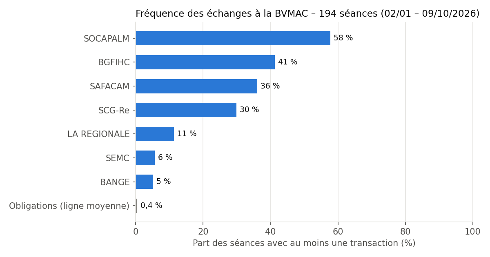
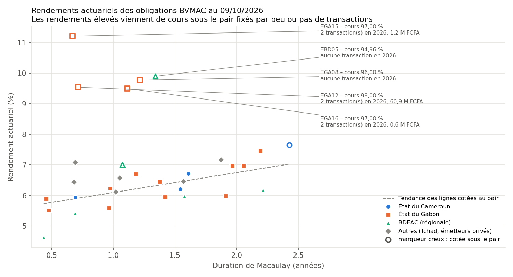
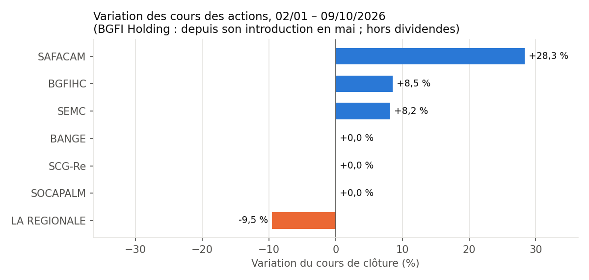

# BVMAC Insight – Observatoire du marché financier de la CEMAC

Chaîne de données et analyse de la **liquidité** et des **rendements obligataires** de la Bourse des Valeurs Mobilières de l'Afrique Centrale (BVMAC), construite à partir des **194 Bulletins Officiels de la Cote** publiés du 2 janvier au 9 octobre 2026.

> **Message principal :** sur 89 % des séances, aucune obligation n'a changé de mains, et 31 lignes obligataires sur 35 ont gardé le même cours toute l'année. Sur un marché aussi peu liquide, le prix affiché ne reflète pas toujours la valeur. Les rendements de 9,5 à 11 % observés sur certaines lignes viennent de cours sous le pair fixés par une poignée de titres, voire par aucune transaction.

---

## Résultats clés (02/01 – 09/10/2026)

| Indicateur | Valeur |
|---|---|
| Séances sans transaction sur les **actions** | 21 % |
| Séances sans transaction sur les **obligations** | 89 % |
| Valeur échangée – actions | 816,7 M FCFA |
| Valeur échangée – obligations | 1 263,1 M FCFA |
| Encours obligataire moyen | 1 320 Md FCFA |
| Taux de rotation obligataire sur la période | 0,10 % |
| Lignes obligataires au cours inchangé | 31 sur 35 |
| Concentration actions (SOCAPALM + BGFI Holding) | 67 % de la valeur échangée |
| Rendement actuariel moyen des souverains | Cameroun 6,63 % · Gabon 7,32 % · Tchad 6,45 % |

### Fréquence des échanges


SOCAPALM est échangée lors de 58 % des séances, BANGE lors de 5 % seulement. La ligne obligataire moyenne n'est échangée que lors de 0,4 % des séances. Autre signe de friction : sur SAFACAM, il y a eu 56 séances avec des ordres d'achat et de vente en carnet, mais aucune transaction, faute d'accord sur le prix.

### Rendements actuariels des obligations


Les lignes cotées au pair forment une courbe cohérente, entre 4,6 et 7,5 % selon la duration. Les points isolés au-dessus correspondent tous à des cours sous le pair. Le cours de 97 % d'EGA15, par exemple, a été fixé par une transaction de 16 titres (environ 158 000 FCFA). EGA08 et EBD05 n'ont enregistré aucune transaction en 2026.

### Variation des cours des actions


---

## Méthode

1. **Collecte** (`01_telecharger_boc.py`) : téléchargement automatique des BOC quotidiens sur bvm-ac.org, à partir de l'adresse type `wp-content/uploads/AAAA/MM/BOC-AAAAMMJJ.pdf`.
2. **Extraction** (`02_extraire_boc.py`) : lecture des PDF avec `pdfplumber`, au niveau des caractères. Les espaces du PDF chevauchent les chiffres et certaines cellules sont collées entre elles. Les colonnes sont donc reconstruites à partir des écarts mesurés entre caractères (moins de 3 pt : même cellule ; plus de 3 pt : changement de colonne). Les lignes sont repérées par leur code ISIN et lues à partir de la colonne « statut », toujours présente. Le script produit 4 tables : synthèse quotidienne, actions, cotation obligataire et caractéristiques des obligations.
3. **Analyse** (`03_analyser.py`) :
   - **Liquidité** : fréquence des séances avec transaction, valeur échangée, concentration, taux de rotation (valeur échangée / encours), ordres non exécutés.
   - **Rendement actuariel** : résolution de *prix plein = Σ flux actualisés* (méthode de Brent), avec prix plein = cours pied de coupon + coupon couru, et règlement-livraison à J+3. **Duration de Macaulay** associée.

### Hypothèses et limites
- Échéancier : coupons et remboursements à périodicité fixe à partir de l'échéance suivante, jusqu'à la dernière échéance de l'année de maturité du titre. Pour les titres à amortissement constant, le nominal restant est réparti à parts égales sur les échéances restantes. Pour une ligne encore en période de différé, le rendement exact peut légèrement différer.
- Rendements calculés avant fiscalité (titres « NET » et « BRUT » traités de la même façon).
- Les variations de cours des actions n'incluent pas les dividendes.

---

## Structure du dépôt

```
01_telecharger_boc.py      téléchargement des bulletins
02_extraire_boc.py         extraction des tableaux des PDF vers CSV
03_analyser.py             indicateurs, rendements, graphiques
data/csv/                  données extraites (194 séances)
resultats/                 tableaux d'indicateurs, graphiques, résumé
```

## Reproduire l'analyse

```bash
pip install -r requirements.txt
python 01_telecharger_boc.py 2026-01-01 2026-10-09   # environ 190 PDF
python 02_extraire_boc.py
python 03_analyser.py
```

---

**Source des données :** Bourse des Valeurs Mobilières de l'Afrique Centrale – [Bulletins Officiels de la Cote](https://www.bvm-ac.org/bulletin-officiel-de-la-cote-boc/). Projet personnel et indépendant, sans lien avec la BVMAC.

**Auteur :** Eugène KEUMANG – Ingénieur statisticien, Data Science & IA appliquée à la finance
